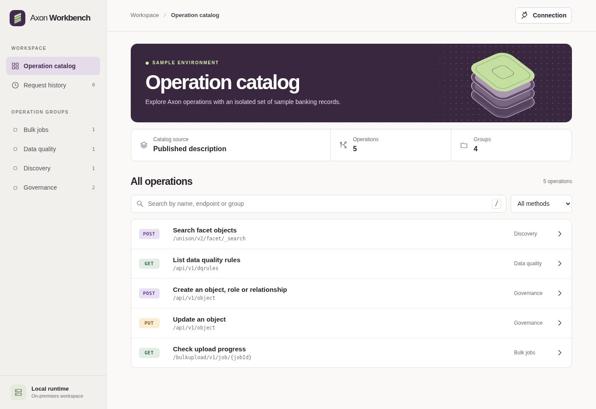
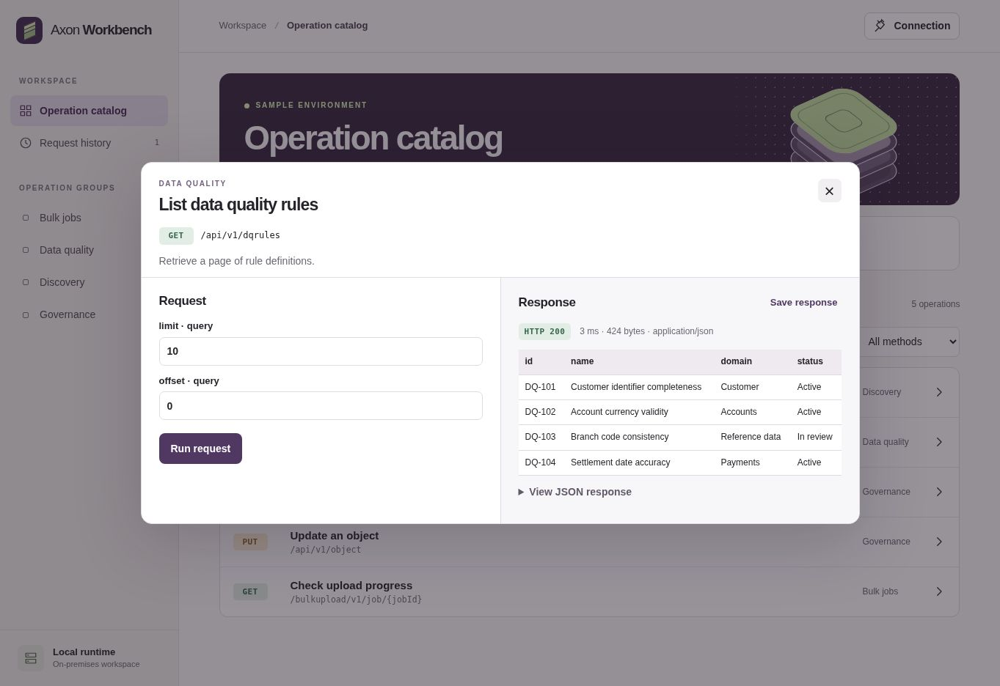
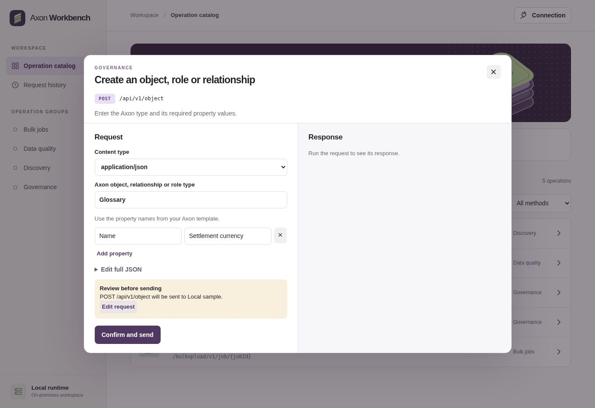

# Axon Workbench

A local, single-operator workbench for Informatica Axon Data Governance. Search the API catalog, fill in parameters, run a request and inspect its response. The included sample uses synthetic banking data. The live connector sends requests to your Axon server from the machine running Workbench.

## Interface

The sample catalog groups five operations across four areas. These screenshots use synthetic banking records from the bundled fixture.



| Query result | Write review |
| --- | --- |
|  |  |

## Start on Windows

Extract the ZIP, open the Axon-Workbench folder and double-click **Start-Workbench.cmd**. Python 3.10 or newer must already be installed. The launcher opens your default browser. Keep its console open while working. To start from PowerShell, run the following in the extracted folder.

```powershell
py -3 app.py --open
```

On Linux or WSL, run `python3 app.py` and open **http://127.0.0.1:8765**. No pip packages, Node installation, CDN, cloud account, telemetry, or database is required. Runtime assets ship in the archive. Stop the console with Ctrl+C.

## Try one complete workflow

1. The workbench opens an isolated **Sample environment**. Select **List data quality rules**, set the limit to 2 and run it. Inspect the table or expand the JSON.
2. Select **Create an object, role or relationship**. Keep the sample type set to Glossary and change the Name property. Run the request, inspect its target and confirm. The local fixture returns HTTP 201 and an identifier.
3. Open **Search facet objects**, choose Glossary and run the search. Your record appears alongside the two original sample terms.
4. Open **Request history** to see the operations and status codes for this tab. Opening a new sample connection resets the sample records.

## Connect to your installation

1. On a machine that can reach Axon, open **Connection**. Enter the application root, including its reverse-proxy prefix if applicable. For example, use `https://axon.example.internal` or `https://governance.example.internal/axon`. Start at the base where Axon's API route prefixes are mounted.
2. Choose an Axon access token, refresh token or Axon/LDAP credentials. Use **No credential** to read a published description anonymously when your server permits it. Workbench exchanges a refresh token through `POST /api/v1/token/refresh` or a login through `POST /api/login_check`, using form-encoded fields. It sends the resulting bearer token to the configured Axon origin. For an SSO-enabled installation, obtain an Axon refresh token through **My Account → Activity Stream → My API Tokens** if enabled for your account. A valid pre-issued access token can also be used.
3. Select **Connect to Axon**. Inspect the catalog source and the status of each metadata request under **API description and discovery details**. Loading a catalog alone does not establish what your account may execute. Start with **List accessible segments** if your catalog includes it, or another narrow read.
4. Filter by group, HTTP method, title or route. The runner provides required fields, query and header parameters, guided editors for Unison search and single-object changes, and an editable request body. Requests using POST, PUT, PATCH or DELETE get a review step. A POST search also uses this step.
5. Inspect Axon's HTTP status, content type, elapsed time and response. Simple JSON record arrays display a table of up to 50 rows and eight scalar columns. Save the full response for additional records or binary downloads. A 202 response is an acceptance acknowledgement. Use the returned job ID with **Check upload progress** for completion.

### How discovery works

| Catalog source | What Workbench uses |
| --- | --- |
| Published description | Fetches the entered application root. Reads a JSON description at that address, follows same-origin service-desc links in HTTP or HTML, and same-origin OpenAPI or Swagger JSON links in HTML. It combines distinct operations from multiple linked documents. When the root has no usable description, it checks openapi.json, swagger.json and v3/api-docs beneath the entered root until it finds a usable description. Discovery uses GET and a bounded queue of up to 12 metadata URLs. |
| Imported JSON | Choose an exported, bundled OpenAPI 3.x or Swagger 2.0 JSON file. Under the same settings you can also specify an exact on-prem description URL. File import can load a catalog before the network is reachable. |
| Reference catalog | If the root responds but discovery yields no specification, Workbench loads 21 documented operations from the Axon 7.2 REST API Guide and a version-specific Marketplace article. This list is a starting point. The installed release, licenses, role and segments determine which calls succeed. |

The reference includes Unison search, accessible segments, single and bulk objects, roles and relationships, value lists, quality rules and scores, external reference links, bulk template upload and field mapping, job status and reports, and Marketplace delivery targets. Source selection is visible in the UI. The app does not infer that Axon's web UI features have equivalent REST functions.

## Local deployment and certificates

The default installation is for one operator, with the application and browser on the same workstation. The listener binds to loopback. Browser sessions are separate. Live tokens reside in process memory and are released on disconnect or idle expiry after 30 minutes. The access token may expire earlier. Reconnect to exchange a fresh token. The connector never retries a write automatically. Local request history keeps 100 operation summaries in tab memory and clears on reload. Saved responses are written only when you download them. Existing Axon-side audit and permission rules apply.

For a private CA, point Workbench at a PEM-encoded certificate bundle before starting it. Optionally pin the allowed installation with AXON_BASE_URL. Live remote connections require HTTPS. The local sample and loopback test servers use HTTP.

```powershell
$env:AXON_CA_FILE = 'C:\certs\bank-root.pem'
$env:AXON_BASE_URL = 'https://axon.example.internal'
py -3 app.py --open
```

### Docker

Run `docker compose up --build -d` in the extracted folder and open the same local address. The mapping only publishes port 8765 on host loopback. The container must resolve and reach Axon's internal hostname. A loopback target inside Docker refers to the container itself. For an offline network, preload the python:3.12-alpine base image from your approved on-prem image supply, or build and transfer the finished image. There are no additional package downloads in the Dockerfile.

To use an internal CA with Compose, create a compose.override.yaml alongside compose.yaml and start the service again.

```yaml
services:
  workbench:
    volumes:
      - ./bank-root.pem:/certs/bank-root.pem:ro
    environment:
      AXON_CA_FILE: /certs/bank-root.pem
```

This distribution targets workstation use. A centrally hosted multi-user service would need its own authenticated front end, HTTPS session handling and corresponding deployment review.

## Compatibility and diagnosis

- OpenAPI support covers common REST operations with local references, the first applicable server URL, flat path/query/header parameters, arrays, JSON or text bodies, simple form fields, multipart files and binary responses. The submitted address provides the default mount point. Swagger basePath and explicit OpenAPI servers override that default. A description can only direct traffic to the configured origin. Workbench ignores a Swagger document's advertised host and uses the chosen Axon host.
- Use a bundled JSON export for YAML or multi-file specifications. Cookie-based authentication, OAuth browser flows, callbacks, webhooks, complex parameter encodings, streaming responses and arbitrary multi-server selection are outside this release. Imported complex schemas may require manual JSON editing. Each request file and upstream response is limited to 12 MiB, and the encoded UI request envelope to 24 MiB.
- A 401 or 403 can indicate an expired credential or insufficient Axon permissions. Inspect the returned payload. Redirects on operation calls are displayed without forwarding credentials to another host. A 404 on a reference operation can indicate a mismatched version or reverse-proxy mount. Replace the fallback with a release-specific description when possible. The discovery detail lists the metadata paths it actually tried.
- If a write times out, the upstream operation may already have happened. Check the object or job status in Axon before sending the request again.

## Verification

Run `python -m unittest discover -s tests -v` in this folder. Eight integration tests exercise the local HTTP UI service, fixture and connector, including catalog discovery, multiple descriptions, authentication, reads, confirmed writes, per-session data isolation, upload/download, fallback, upstream errors, local references and origin checks. These tests use local fixtures. The sample catalog, a data quality query returning HTTP 200, and the glossary write-review screen were verified in Chrome. Live Informatica interoperability and the Docker container runtime still require verification in your environment.

## API references

- [Informatica Axon REST API resources](https://success.informatica.com/success-accelerators/axon-data-governance---rest-apis-.html)
- [Axon Data Governance 7.2 REST API Guide, accessible copy](https://www.scribd.com/document/508316053/Ax-72-Rest-API-Guide-En)
- [Informatica on SSO and API refresh tokens](https://knowledge.informatica.com/s/article/000260002?language=en_US)
- [Informatica Marketplace delivery-target API](https://knowledge.informatica.com/s/article/Retrieve-the-Delivery-targets-linked-with-Data-collection-using-REST-API-in-Axon?language=en_US)
- [Informatica Unison v2 search](https://knowledge.informatica.com/s/article/Axon-REST-API-call-returning-only-30-related-items-whereas-the-total-hits-is-more-than-30?language=en_US)
